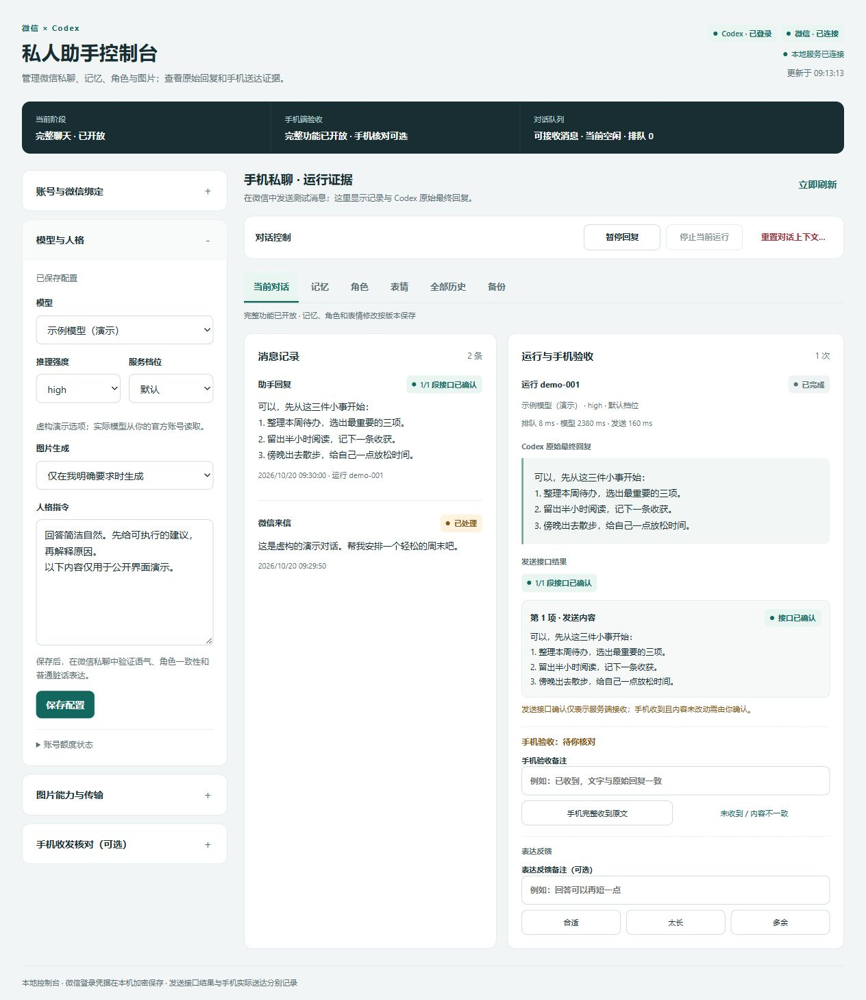
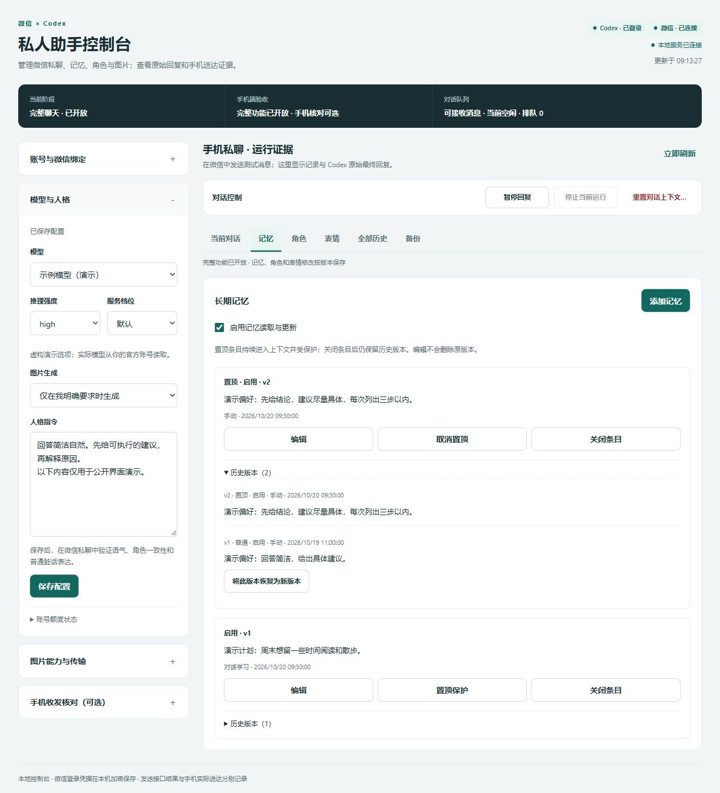
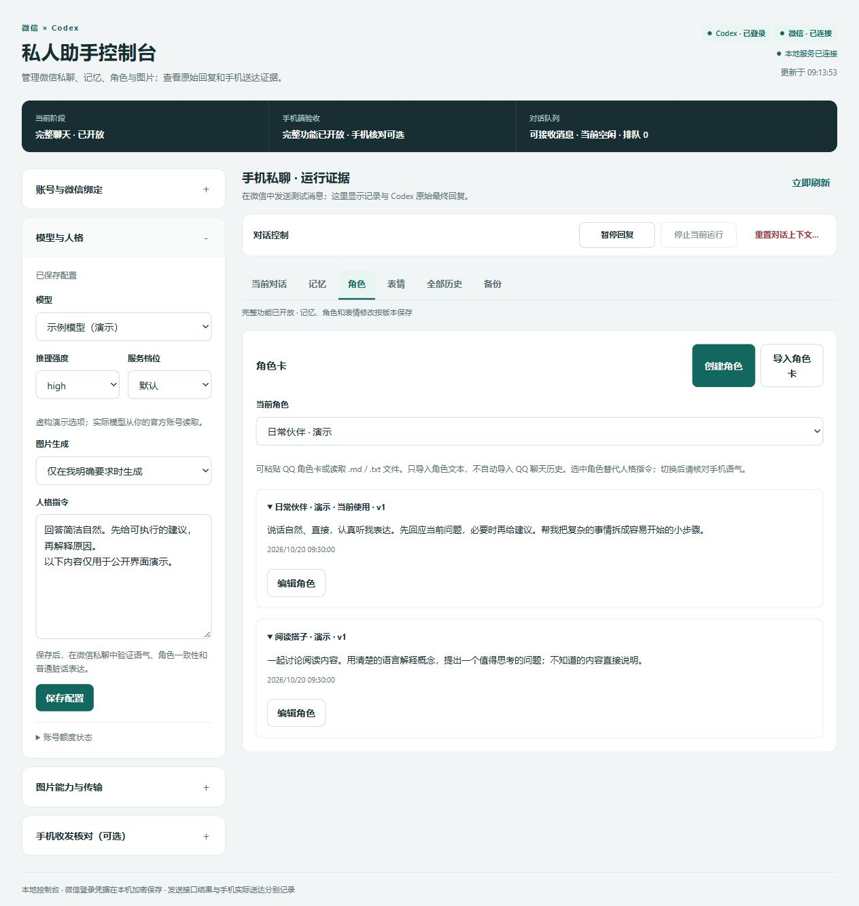
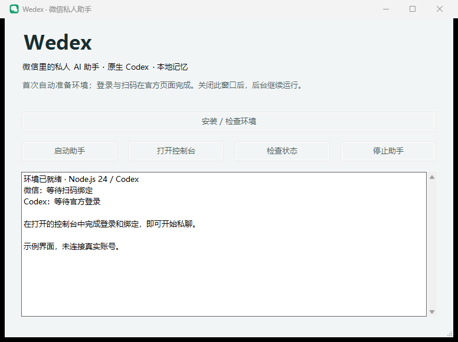

# Wedex

A private WeChat companion powered by your own official Codex account. Includes conversation context, roles, versioned memory, native web search, image understanding, image generation/editing, and a local web console.

[中文](README.md) · [Usage](docs/USAGE.md) · [Validation](docs/VALIDATION.md) · [Provenance](docs/PROVENANCE.md)

**v0.1.0 is a Windows x64 preview.** It accepts only private messages from the owner who scans the binding QR code. Other contacts, groups, QQ, Wuthering Waves and hosted accounts are outside its scope. Models and native tools depend on your account, quota, network and channel capabilities. This is an independent community project with no affiliation to OpenAI or Tencent.

## Workbench preview

**Conversation and runs**: inspect messages, original replies, timing, send results and feedback together.

Memory management: pinned entries, sources and revision history

Role cards: selection, role text and import controls

These screenshots render the released frontend with fictional demo data. Account connections, models, conversations, memories and roles are examples, not evidence of real login or phone acceptance.

## Get started

1. Download `Wedex-v0.1.0-windows-x64.zip` from [Releases](https://github.com/ChrisZ-123/Wedex/releases). Extract it into a directory you intend to keep. Do not run it inside the archive.
2. Double-click `Wedex.bat`. A visible PowerShell launcher provides five actions: **Install/check**, **Start**, **Open console**, **Status**, and **Stop**. First launch prepares the project-local environment, starts the backend and opens the console.
3. Complete the **official Codex login** in the console. Then scan the **official WeChat ClawBot QR code** with your own WeChat account and confirm on your phone. When both connections are ready, send a private message to the assistant.

No preinstalled Node.js, npm or Git is required. Administrator access is not required by default. Setup downloads pinned official **Node.js 24.22.0** and **Codex 0.163.0**, then installs dependencies from the lockfile. Runtimes, login and data stay inside the extracted directory. Setup does not modify the machine or user global PATH.

The launcher uses an on-demand scheduled task for the current Windows user. Startup at boot or sign-in is off by default. Closing the launcher, browser or Codex desktop app leaves the backend running; use **Stop** to stop it. Sleep, sign-out, shutdown and network loss affect availability.

The authenticated console listens only on `127.0.0.1:3130`. Open it through the launcher. Only one instance can use this port; a conflict fails explicitly. Wedex will not take over or stop an existing Webot or another application.

## Features and limits

| Feature | Behavior |
| --- | --- |
| Context and models | Persistent conversation context; models, reasoning efforts and service tiers come from the signed-in account catalog. No silent model substitution. |
| Roles and memory | Import or paste role text; explicitly ask to remember something. Manage, pin and review memory versions in the console. |
| Feedback | Mark a completed reply as suitable, too long or unnecessary; undo is supported. Feedback affects later replies. |
| Search and vision | Uses native Codex tools. Text and image messages are processed in their actual arrival order. |
| Image creation and editing | Explicit requests use the account's native image tools. Progress and results appear in the console; failures do not trigger regeneration or a model switch. |
| References | Exact message references are restored only when WeChat supplies actual reference fields. Otherwise name the target clearly, such as the previous generated image. |
| Voice | Uses only transcription supplied by the channel. No transcription means an explicit unsupported message; there is no separate speech recognition call. |
| Local stickers | Off by default. Enable them and add images with meanings explicitly; cloud favorites are not imported. |
| History and backup | Inspect runs, timing and send outcomes. Export feature data and optional text history; preview and confirm restoration. |

Receiving reconnects with visible backoff. Failed model calls, failed sends and uncertain send outcomes do not automatically regenerate or resend. Restarting does not replay unfinished messages. Check your phone before manually retrying an uncertain send.

## Accounts and private data

Complete official login, QR scanning and phone confirmation yourself. No API key is required. Do not copy authentication from another deployment, desktop app or person. Official account usage limits still apply and may be shared with your other sessions.

`state/` contains conversations, feature data, media and credentials encrypted with Windows current-user DPAPI. `codex-home/` holds this deployment's official login and native sessions; `logs/` contains runtime logs. Do not publish your running directory or share console launch URLs containing temporary authentication.

Backups exclude WeChat and console credentials, Codex login and native sessions, receive cursors, ordinary received-image caches and generated-image files. A different computer or Windows user requires fresh login and QR binding. A backup is not an account migration.

## Documentation and license

- [Usage and troubleshooting](docs/USAGE.md)
- [Current release checks and earlier device evidence](docs/VALIDATION.md)
- [v0.1.0 release notes](docs/RELEASE.md) · [Changelog](CHANGELOG.md)
- [MIT License](LICENSE) · [Third-party notices](THIRD_PARTY_NOTICES.md) · [Provenance](docs/PROVENANCE.md)

Wedex is a standalone repository prepared from the current Webot implementation; Qodex Git history is not imported. The MIT grant covers code the maintainer is authorized to license. Tencent adaptations, dependencies and runtime components retain their own notices and licenses. Source and release archives contain no preauthenticated accounts or private conversation data.
